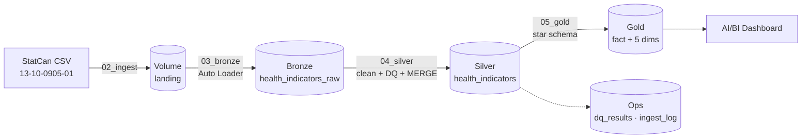

# Canadian Health Indicators Lakehouse

An end-to-end data engineering project on **Databricks**. It ingests official health survey data from **Statistics Canada**, moves it through a **Bronze → Silver → Gold** medallion architecture with data-quality checks, models it as a **star schema**, and serves it in an **AI/BI dashboard**. The whole pipeline runs as a parameterized **Databricks Job** straight from this repository's `main` branch.

## Business question

> How do Canadians rate their own physical and mental health, and how has that changed across provinces, age groups and sexes over the last decade?

The data is real public data: **Statistics Canada Table 13-10-0905-01, *Health indicator statistics, annual estimates*** (Canadian Community Health Survey). It covers 38 health indicators, 11 geographies, 5 age groups and both sexes, from 2015 to 2025.

## Architecture



| Layer | Schema | What it holds |
|---|---|---|
| Landing | `{env}_bronze.landing` (volume) | Raw CSV files, one folder per run date |
| Bronze | `{env}_bronze` | Raw data as text, plus source file and ingest time |
| Silver | `{env}_silver` | Typed, trimmed, de-duplicated data, one row per `vector + year` |
| Gold | `{env}_gold` | Star schema for reporting |
| Ops | `{env}_ops` | Data-quality results and run log |

## Tech stack

- **Databricks Free Edition** (serverless compute, SQL warehouse)
- **Unity Catalog**: catalogs, schemas, volumes
- **PySpark** and **Spark SQL**
- **Auto Loader** (`cloudFiles`) for incremental file ingestion
- **Delta Lake**: `MERGE`, constraints, time travel, `OPTIMIZE`
- **Databricks Jobs** running from Git
- **Databricks AI/BI Dashboards**
- **Git / GitHub**: one branch and pull request per phase

## Repository structure

```
notebooks/
├── 00_config.ipynb    # Widgets (env, catalog, table_id, run_date) and all names/paths in one place
├── 01_setup.ipynb     # Creates the four schemas and the landing volume
├── 02_ingest.ipynb    # Downloads the StatCan zip; falls back to files already in landing
├── 03_bronze.ipynb    # Auto Loader → Bronze table
├── 04_silver.ipynb    # Clean, type, de-duplicate, data-quality checks, MERGE, run log
└── 05_gold.ipynb      # Star schema, key tests, OPTIMIZE
Indicators Health Canadian.lvdash.json   # AI/BI dashboard definition
```

## How the pipeline works

**1. Configuration (`00_config`)**
Every notebook starts with `%run ./00_config`. One `env` parameter decides whether the code writes to `dev_*` or `prod_*` schemas, so the same code runs in both environments without any changes.

**2. Ingest (`02_ingest`)**
Downloads the zip from StatCan and extracts only the data CSV into a dated folder. If the download fails, it continues with files already in the landing volume. If the volume is empty, it stops with a clear message.

**3. Bronze (`03_bronze`)**
Auto Loader reads only new files (`trigger(availableNow=True)` with a checkpoint). It keeps every column as text, normalizes column names to `snake_case`, and adds `_source_file` and `_ingested_at` for lineage.

**4. Silver (`04_silver`)**
- Takes the latest file only, and checks that all expected columns exist.
- Casts types, trims text, and removes duplicates on `vector + year`.
- Runs data-quality rules and writes the results to `ops.dq_results`.
- Upserts into Silver with Delta `MERGE`, so re-runs never create duplicates.
- Adds a `CHECK` constraint on `year` and writes one row per run to `ops.ingest_log`.

**5. Gold (`05_gold`)**
Builds a star schema with `xxhash64` surrogate keys, then tests every dimension for duplicate keys and orphan fact rows before the dashboard reads it.

## Data quality rules

| Rule | Severity | Check |
|---|---|---|
| `not_null_keys` | critical | Year, geography, indicator, characteristic and vector are never null |
| `year_in_range` | critical | Year is between 2000 and the current year |
| `source_duplicates` | warning | Number of duplicate `vector + year` rows removed |
| `percent_between_0_and_100` | warning | Percentage values stay between 0 and 100 |
| `value_missing` | info | Values suppressed by StatCan |

If a **critical** rule fails, the run stops before `MERGE` and Silver is not updated.

## Gold data model

| Table | Grain / content |
|---|---|
| `fact_health_indicator` | One row per geography × indicator × age/sex × measure × year: `value`, `status`, `symbol` |
| `dim_geography` | Canada and the provinces, with StatCan `dguid` |
| `dim_indicator` | 38 health indicators |
| `dim_demographic` | Age group × sex |
| `dim_measure` | Characteristic (percent, number, confidence interval) and unit |
| `dim_year` | Year, with an `is_latest_year` flag |

## Orchestration

A Databricks Job runs `01_setup → 02_ingest → 03_bronze → 04_silver → 05_gold` from the **`main`** branch of this repository with `env = prod`. `run_date` comes from `{{job.start_time.iso_date}}`. Only code that has been reviewed and merged reaches production.

## Run it yourself

1. Create a free account on **Databricks Free Edition**.
2. Add this repository as a **Git folder** in your workspace.
3. Run `01_setup` with `env = dev`.
4. Run `02_ingest`. Free Edition restricts outbound internet, so if the download fails, download the CSV from the [StatCan table page](https://www150.statcan.gc.ca/t1/tbl1/en/tv.action?pid=1310090501) and upload `13100905.csv` to `/Volumes/workspace/dev_bronze/landing/statcan/13100905/<YYYY-MM-DD>/`.
5. Run `03_bronze`, `04_silver` and `05_gold` in order.
6. Import `Indicators Health Canadian.lvdash.json` as a dashboard.

## Example question answered in Gold

```sql
SELECT y.year, g.geography, ROUND(f.value, 1) AS percent
FROM workspace.dev_gold.fact_health_indicator f
JOIN workspace.dev_gold.dim_geography   g ON f.geo_key = g.geo_key
JOIN workspace.dev_gold.dim_indicator   i ON f.indicator_key = i.indicator_key
JOIN workspace.dev_gold.dim_measure     m ON f.measure_key = m.measure_key
JOIN workspace.dev_gold.dim_demographic d ON f.demo_key = d.demo_key
JOIN workspace.dev_gold.dim_year        y ON f.year = y.year
WHERE i.indicator LIKE '%mental health%'
  AND m.characteristic LIKE 'Percent%'
  AND g.geography IN ('Ontario', 'Canada (excluding territories)')
  AND d.age_group LIKE 'Total%' AND d.sex LIKE 'Both%'
ORDER BY y.year, g.geography;
```

## Data source and licence

Source: Statistics Canada. *Table 13-10-0905-01 Health indicator statistics, annual estimates.* Contains information licensed under the [Statistics Canada Open Licence](https://www.statcan.gc.ca/en/reference/licence).

## Author

**Mehrdad Mansourdehghan**, Data Analyst / Data Scientist
